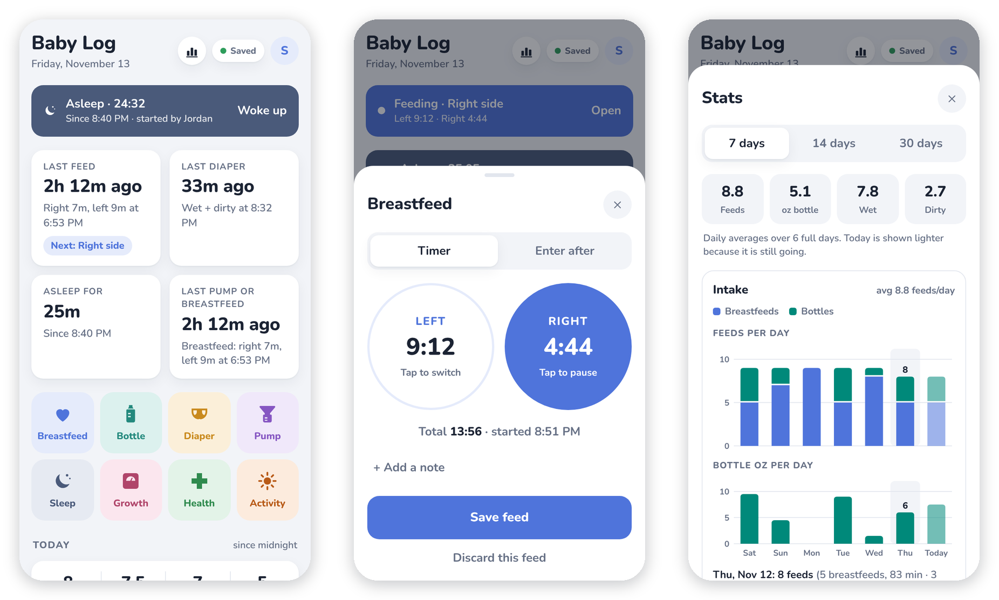
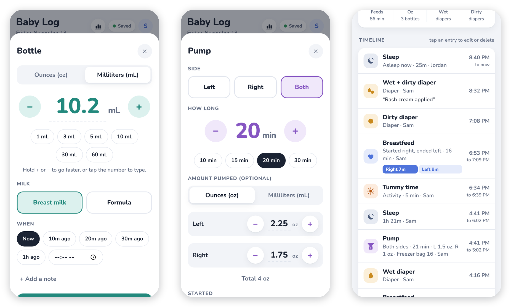
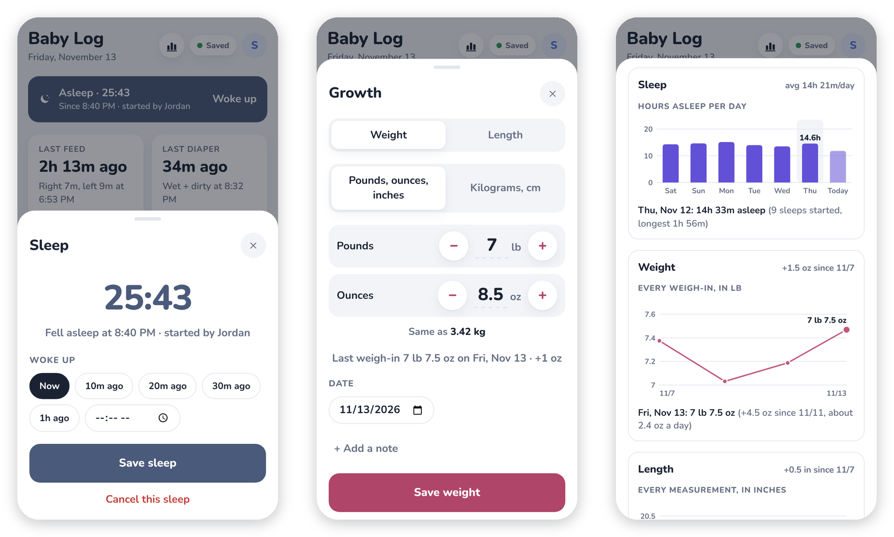
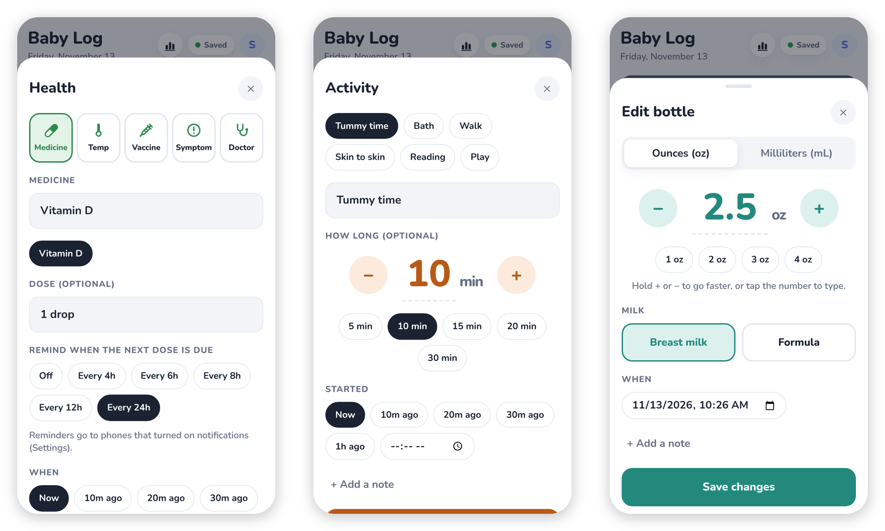
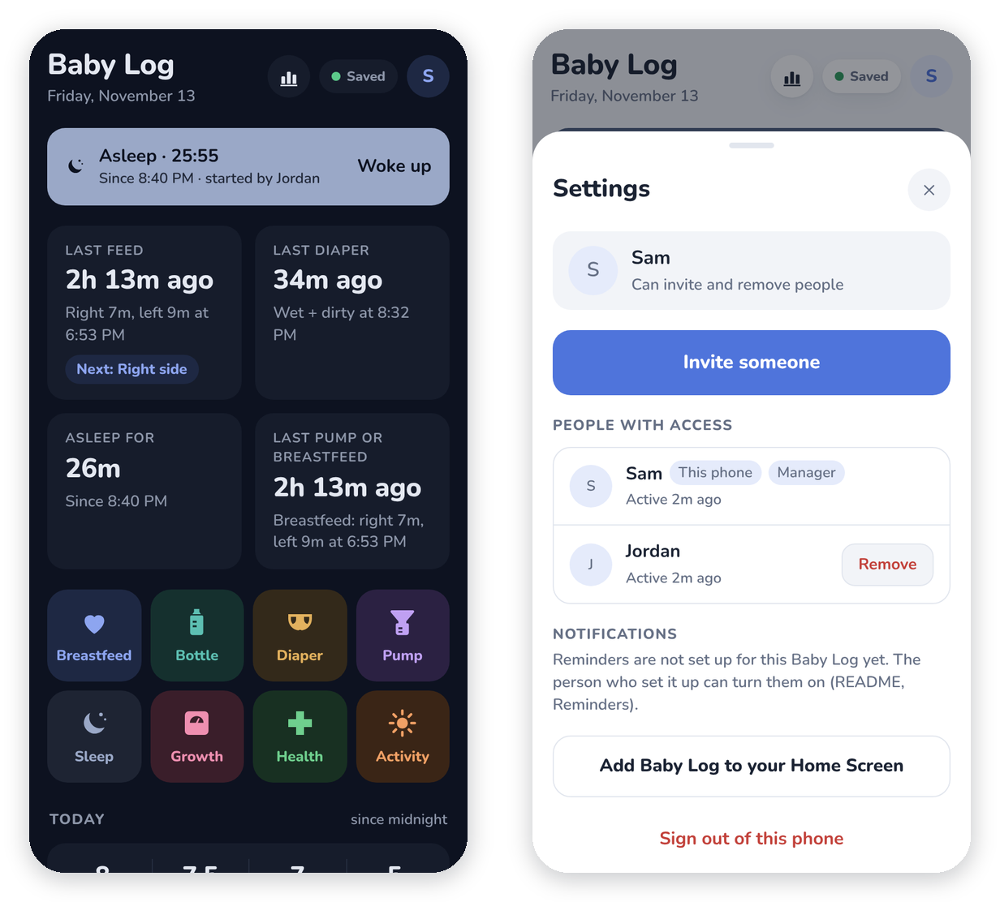

# Baby Log

A phone app for logging a newborn's feeds, diapers, sleep, growth and health, shared by everyone who cares for the baby. Entries go into a private Google Sheet that you own.



- **Breastfeeds:** a left and right timer (tap to start, switch or pause) that every phone shares, so a feed started on one phone can be switched, paused or saved on another. Or enter minutes per side after the fact (type them or use + and -). Records which side you started and ended on. A pause or side switch of up to 30 minutes stays one feed. A side left running over 45 minutes asks "Still feeding?".
- **Bottles and syringes:** ounces or mL (0.1 mL steps), and breast milk or formula.
- **Diapers:** wet, dirty, or both.
- **Pumping:** left, right or both, minutes, how much came from each breast (oz or mL, optional), and an optional storage label (for example, "Bag 12").
- **Sleep:** start a timer when the baby falls asleep and anyone can end it from their own phone at wake-up, or enter the start and end afterwards. Home shows how long the baby has been asleep or awake.
- **Growth:** weight (pounds and ounces, or kilograms) and length (inches or cm). Measurements can be backdated up to a year, so birth weight and length can go in too.
- **Health:** medicine and doses (with an optional "remind me when the next dose is due"), temperature (°F or °C), vaccines, symptoms and doctor visits.
- **Activities:** tummy time, bath, walks or anything you type, with optional minutes.
- **Edit anything:** tap an entry to change its time, amounts, sides or details, or to delete it. Undo is offered after every change (or **Keep separate**, when a breastfeed was added to the one before it).
- **Stats:** daily averages and per-day charts for feeds (breastfeeds and bottles), bottle amount split into breast milk and formula, milk removal (breastfeeds plus pumps, with the longest stretch between them), wet and dirty diapers and hours asleep over the last 7, 14 or 30 days, with a table view, plus weight and length charts of every measurement with the change between them.
- **Notes** on any entry, when you log it or later from the timeline.
- **Backdating** ("20 minutes ago" or an exact time) for entries logged after the fact.
- **Reminders (optional):** notifications when a feed is due, when the breastfeed timer has run too long, or when the next dose of a medicine is due. Each person picks their own.
- **Works offline:** entries wait on the phone and save when it reconnects. Tap the sync pill to see anything still waiting and why.
- Runs on iPhone, Android or any phone browser, and can be added to the Home Screen like an app. Nobody needs a Google account except the person who sets it up.









<sub>Screenshots use made-up sample data.</sub>

It costs nothing to run: the app is hosted free on GitHub Pages and the data lives in your own Google account.

Optionally, log diapers and bottles hands-free by saying "Hey Google, log a wet diaper" to any Google speaker in the house (see [Log by voice with Google Home](#optional-log-by-voice-with-google-home)), and turn on [reminder notifications](#optional-reminder-notifications).

## How it fits together

```
Phone (Baby Log app, served from GitHub Pages: screens only, no data, no keys)
  │  HTTPS, device key in the request body
  ▼
Apps Script attached to your Baby Log sheet (apps-script/Code.gs)
  • @OnlyCurrentDoc: can reach this one spreadsheet and nothing else in your Drive
  • checks the device key on every request
  • can only add, change, list and delete entries, share the feed timer, and manage invites
  ▼
Your Baby Log Google Sheet (never shared or published)

Optional, on your own Google Cloud (google-home/server.js on Cloud Run):
  • Google Home voice commands  → the same Apps Script
  • reminders: every 5 minutes the Apps Script checks what is due and hands notifications
    to this service, which encrypts and delivers them to the phones that turned them on
```

---

## Set it up for your family

Allow about 20 minutes. You need a Google account (a regular Gmail account works) and a free GitHub account. You don't need to install anything or write code.

### 1. Copy this repository

1. On GitHub, click **Fork** (or **Use this template**) to make your own copy.
2. Keep the copy **Public**. GitHub Pages is free only for public repositories. That's safe here: the code has no keys or data in it (see [Security](#security)).

Your app's address will be `https://YOUR-GITHUB-NAME.github.io/YOUR-REPO-NAME/`. You'll need it in step 4. For example, a repository named `BabyLog` under `jane` is `https://jane.github.io/BabyLog/`.

### 2. Turn on GitHub Pages

1. In your copy, go to **Settings → Pages**.
2. Under **Build and deployment**, set Source to **Deploy from a branch**, pick **main** and **/(root)**, then click **Save**.

After a minute or two, your app's address shows "Baby Log is almost ready." That's expected until step 7.

### 3. Create the Google Sheet

1. Go to [sheets.new](https://sheets.new) and give the sheet a name, such as "Baby Log".
2. Go to **File → Settings** and set **Time zone** to your local time zone, so times in the sheet display correctly.

Leave it blank. The setup script creates every tab it needs.

### 4. Add the script to the sheet

1. In the sheet, go to **Extensions → Apps Script**. A new tab opens with a file named `Code.gs`.
2. Delete everything in it, then paste in the full contents of [`apps-script/Code.gs`](apps-script/Code.gs) from this repository.
3. Near the top, change these two lines:
   ```js
   const APP_URL = 'https://YOUR-GITHUB-NAME.github.io/YOUR-REPO-NAME/';  // keep the trailing slash
   const OWNER_NAME = 'Your first name';
   ```
4. Click **Save** (the disk icon).

The script must be opened from the sheet with **Extensions → Apps Script**. A script created separately at script.google.com isn't attached to the sheet and won't work.

### 5. Run setup

1. In the function menu at the top of the editor, choose **setup**, then click **Run**.
2. Google asks for permission:
   - It warns that the app isn't verified, because it's your own script. Click **Advanced**, then **Go to (project name)**.
   - The permission list should only ask to view and manage **this spreadsheet**. That's the `@OnlyCurrentDoc` line doing its job. If it asks for your whole Drive, stop and check that you pasted the file exactly.
3. Your sheet now has these tabs:

| Tab | What it holds |
|---|---|
| **Dashboard** | Last feed, diapers, pump, wake-up, weight, length and medicine, and 24-hour and since-midnight totals including pumps, milk removal and hours asleep |
| **Daily** | Per-day totals, including pumps, milk removal and hours asleep |
| **Timeline** | Every entry, newest first, one line each (read-only: it is a formula over the tabs below) |
| **Feeds, Pumps, Diapers, Sleep, Growth, Health, Activities** | One row per entry, a tab for each kind. This is where the app writes. See [The entry tabs](#the-entry-tabs). |
| **Devices** | Each phone with access: who, when it was last used, and whether it's active |
| **Invites** | Invite links and setup codes. Codes are stored only as hashes. |

### 6. Deploy the script as a web app

1. In the Apps Script editor, click **Deploy → New deployment**.
2. Click the gear icon next to "Select type" and choose **Web app**.
3. Set **Execute as: Me** and **Who has access: Anyone**, then click **Deploy**.
4. Copy the **Web app URL**. It looks like `https://script.google.com/macros/s/.../exec`.

"Anyone" means the app can reach the script without a Google sign-in. The script itself still refuses every request that lacks a valid device key.

**Using Google Workspace (a work or custom-domain account)?** If "Anyone" isn't offered, an admin needs to allow sharing outside your organization: **Admin console → Apps → Google Workspace → Drive and Docs → Sharing settings**.

### 7. Connect the app to your script

1. In your GitHub copy, open `config.js` and click the pencil icon to edit it.
2. Paste your Web app URL between the quotes:
   ```js
   window.BABYLOG_CONFIG = {
     apiUrl: 'https://script.google.com/macros/s/.../exec'
   };
   ```
3. Click **Commit changes**. GitHub Pages updates within a minute or two.

### 8. Sign yourself in

1. Back in the Apps Script editor, choose **createOwnerInvite** in the function menu and click **Run**.
2. Open **Execution log** at the bottom. It shows a link like `https://.../#invite=...`.
3. Open that link on your phone and tap **Join Baby Log**. The link works once and expires after 3 days.

You're signed in as a manager, which means you can invite and remove people.

### 9. Invite everyone else

In the app, tap your initial at the top right, then **Invite someone**. Enter a name and choose whether they can manage access, then send the link with **Share** or **Copy link**. Each link works once and expires after 3 days.

### 10. Add it to the Home Screen

The app offers this after someone joins, and it's always available under Settings.

- **iPhone:** in Safari, tap **Share → Add to Home Screen**. iPhone gives Home Screen apps their own storage, so the app shows an 8-character **setup code**. Open Baby Log from the Home Screen and type the code. It works once and expires after 15 minutes.
- **Android:** in Chrome, tap **Install** when prompted, or use **⋮ → Add to Home screen**.

---

## Optional: log by voice with Google Home

Say a phrase like **"Hey Google, log a wet diaper"** to any Google speaker or display in the house, and the entry lands in the sheet and the app within a couple of seconds. Anyone in the home can use it, including a caregiver without a Google account.

| Say "Hey Google, ..." | Logs |
|---|---|
| log a wet diaper | Wet diaper |
| log a dirty diaper | Dirty diaper |
| log a wet and dirty diaper, or log a dirty and wet diaper | Wet + dirty diaper |
| log a bottle feed of 1 ounce of breast milk | Bottle, 1 oz, breast milk |
| log a bottle feed of 2 ounces of breast milk | Bottle, 2 oz, breast milk |
| log a bottle feed of 3 ounces of breast milk | Bottle, 3 oz, breast milk |
| log a bottle feed of 4 ounces of breast milk | Bottle, 4 oz, breast milk |
| log a bottle feed of 6 ounces of breast milk | Bottle, 6 oz, breast milk |
| log a bottle feed of 8 ounces of breast milk | Bottle, 8 oz, breast milk |
| log a bottle feed of 1 ounce of formula | Bottle, 1 oz, formula |
| log a bottle feed of 2 ounces of formula | Bottle, 2 oz, formula |
| log a bottle feed of 3 ounces of formula | Bottle, 3 oz, formula |
| log a bottle feed of 4 ounces of formula | Bottle, 4 oz, formula |
| log a bottle feed of 6 ounces of formula | Bottle, 6 oz, formula |
| log a bottle feed of 8 ounces of formula | Bottle, 8 oz, formula |

That's 15 commands. Entries are logged at the moment they're said, with no note; fix the time or add a note in the app if needed.

Google Home only supports fixed phrases for this, so each amount is its own command. Amounts, times and notes can't be spoken freely.

Google Home can't write to a sheet by itself, so this adds a small private service on your own Google Cloud. Google Home sees it as 15 scenes, one per command; a household routine turns a scene on when someone says its phrase.

```
"Hey Google, Baby Log wet diaper"
  → Google Home household routine → turns on the "Baby Log wet diaper" scene
  → your Cloud Run service (google-home/server.js) → the same Apps Script the app uses
  → new row in the Diapers tab, shown in the app as logged by "Google Home"
```

If two speakers both hear the same command, it is logged once: the script keeps one of two identical voice entries made within a minute of each other.

It runs within Cloud Run's free tier. You need a Google Cloud project with billing enabled (free-tier use isn't charged), about 45 minutes, and the app already working.

### A. Give the service its own key
In the Baby Log app, tap your initial → **Invite someone** → name it **Google Home**, leave **Can invite and remove people** off → **Create invite link** → **Copy link**. Keep it for the next step. You can remove "Google Home" from People with access at any time to cut voice logging off.

### B. Deploy the service
1. Open [Google Cloud Shell](https://shell.cloud.google.com) and select your project: `gcloud config set project YOUR_PROJECT_ID`
2. Run:
   ```bash
   git clone https://github.com/YOUR-GITHUB-NAME/YOUR-REPO-NAME && cd YOUR-REPO-NAME/google-home && ./deploy.sh
   ```
3. Paste the invite link when asked. After a few minutes the script prints an **OAuth Client ID**, **Client secret**, **Authorization URL**, **Token URL**, **Cloud fulfillment URL** and a **Link passcode**. Keep that window open.

The script saves these settings in `~/.babylog-home.env` in Cloud Shell, so running it again later redeploys without breaking the link.

### C. Register the integration with Google Home
1. Go to the [Google Home Developer Console](https://console.home.google.com), click **Create a project**, and pick your Google Cloud project when asked.
2. Click **Add Cloud-to-cloud integration** and go through to **Setup & configuration**.
3. Fill in:
   - **Integration name:** Baby Log
   - **Device type:** Scene
   - **App icon:** upload `google-home/icon-144.png` from this repository
   - **Account linking:** the OAuth Client ID, Client secret, Authorization URL and Token URL from step B. Leave scopes empty.
   - **Cloud fulfillment URL:** from step B
4. Click **Save**. You don't need to submit it for certification; it stays private to your project.
5. Open the **Test** tab of the integration and click **Test**. This is what makes it appear in the Google Home app for your account. Do it with the same Google account your Google Home app uses.

**If Import or Create project fails with `Permission 'nestconsole.smarthomeProjects.create' denied`,** your account needs Google Home's developer role on the project. In Cloud Shell:
```bash
P=YOUR_PROJECT_ID; ME=you@example.com
ROLE=$(for r in $(gcloud iam roles list --filter="name:nestconsole" --format="value(name)"); do gcloud iam roles describe "$r" --format="value(includedPermissions)" | grep -q "nestconsole.smarthomeProjects.create" && echo "$r" && break; done)
gcloud projects add-iam-policy-binding "$P" --member="user:$ME" --role="$ROLE" --condition=None
```
Wait a couple of minutes and try again.

**If your Google Home app uses a different Google account than your Cloud project** (for example, the project is on a Google Workspace account and your home is on a personal Gmail account), give that account access and run the test as that account:
1. If the Cloud project belongs to a Workspace organization, allow outside accounts on this project only (outside accounts are blocked by default):
   ```bash
   P=YOUR_PROJECT_ID
   ORG=$(gcloud projects get-ancestors $P --format='value(id,type)' | awk '$2=="organization"{print $1}')
   gcloud services enable orgpolicy.googleapis.com
   gcloud organizations add-iam-policy-binding "$ORG" --member="user:YOUR_WORKSPACE_EMAIL" --role="roles/orgpolicy.policyAdmin" --condition=None
   printf 'name: projects/%s/policies/iam.allowedPolicyMemberDomains\nspec:\n  rules:\n  - allowAll: true\n' "$P" > policy.yaml
   gcloud org-policies set-policy policy.yaml
   ```
2. Grant the Google Home account the developer role found above and Editor on the project:
   ```bash
   gcloud projects add-iam-policy-binding "$P" --member="user:YOUR_HOME_EMAIL" --role="$ROLE" --condition=None
   gcloud projects add-iam-policy-binding "$P" --member="user:YOUR_HOME_EMAIL" --role="roles/editor" --condition=None
   ```
3. In a browser signed in only as the Google Home account, open `https://console.home.google.com/projects/YOUR_PROJECT_ID`, accept the terms, open the integration's **Test** tab and click **Test**. Wait 5 to 10 minutes before linking.

### D. Link it in the Google Home app
1. On your phone, open the **Google Home** app → **+** → **Link app or service** (called **Works with Google Home** in some versions).
2. Search for **Baby Log** and tap the entry named **[test] Baby Log**. If it isn't there, recheck step C.5 and that the Google Home app is signed in to the same account, then fully close and reopen the app. A Baby Log page opens; type the **Link passcode** from step B and tap **Link**.
3. The 15 scenes are now available, named like the phrases in the table above. They may not appear under All devices; that is normal. Check by saying "Hey Google, activate Baby Log wet diaper" and confirming the entry shows up in the app.

Only the person who owns the Google Cloud project does this. Everyone else in the home uses it through the routines below.

### E. Add the voice commands
All 15 commands go in at once as one script, from a computer:

1. Sign in to [home.google.com](https://home.google.com) with the account your Google Home uses, open **Automations**, and click **Add new**.
2. Paste the full contents of [`google-home/routines.yaml`](google-home/routines.yaml).
3. Change every `Office speaker - Office` to one of your own speakers, written exactly as the Google Home app shows it (`Device name - Room name`). The editor suggests valid names as you type, and Find and replace changes all 15 at once.
4. Click **Validate**, then **Save**.
5. Try it: say **"Hey Google, log a wet diaper"** to any speaker. It answers "Activating Baby Log wet diaper", and the entry appears in the app within a few seconds. Delete the test entry from the app's timeline afterwards.

Notes:
- **Any speaker works.** The phrases are heard by every speaker in the home, and the confirmation plays on the one you spoke to. The speaker named in the script is required by the editor but doesn't limit where the commands work.
- **Anyone in the home can use them,** including guests, with no setup on their side.
- **Changing a phrase:** edit the `is:` lines in the script and save. Each `okGoogle:` line must stay exactly `activate` plus the scene name, which is what reaches the service.
- **If Validate rejects `assistant.event.OkGoogle`,** change those lines to `assistant.command.OkGoogle`; Google's documentation uses both spellings.
- **If a phrase gets a reply other than "Activating Baby Log ...",** Google matched it to one of its built-in commands. Reword that phrase in the script.
- Saying "Hey Google, activate Baby Log wet diaper" also works with no script at all, which is handy for checking the service.

### Changing or removing it
- **Cut off voice logging:** remove **Google Home** under Settings → People with access in the app.
- **Unlink:** in the Google Home app, open any Baby Log scene → Settings → Unlink.
- **Change the passcode or force a re-link:** edit `~/.babylog-home.env` in Cloud Shell and run `./deploy.sh` again.
- **Add more voice commands:** add an entry to `SCENES` at the top of `google-home/server.js`, run `./deploy.sh`, say "Hey Google, sync my devices", then add a matching automation to the script at home.google.com.
- **Delete it:** `gcloud run services delete babylog-home --region us-east1`

## Optional: reminder notifications

Each person can get a notification on their phone, even with the app closed, when:

- **a feed is due:** no feed for 2, 2.5, 3 or 4 hours (their choice)
- **the breastfeed timer has run long:** one side over 45 minutes, usually a timer someone forgot to stop
- **a medicine is due:** when logging a dose, pick "Remind when the next dose is due" (every 4 to 24 hours)

How it works: every 5 minutes the Apps Script checks the sheet. When something is due it hands the notification to the cloud service from the Google Home section, which encrypts it and delivers it through the phone's own notification service (Apple, Google or Mozilla). Each alert is sent once.

```
Apps Script, every 5 minutes: is a feed, timer or dose due?
  → POST /push with a secret only it knows → your Cloud Run service
  → Web Push (encrypted, signed with your own VAPID key) → the phones that turned notifications on
```

Set it up once:

1. **Update the script.** Paste the latest `apps-script/Code.gs` into Apps Script and click **Save**.
2. **Turn reminders on.** In the function menu choose **setupReminders** and click **Run**. Google asks for two new permissions: to connect to an external service (your cloud service) and to run while you're not using it (the 5-minute check). It still only reaches this one spreadsheet.
3. **Publish a new version** of the web app (see [Making changes later](#making-changes-later)).
4. **Deploy the cloud service.** If you set up Google Home voice commands, run `git pull` and then `./deploy.sh` again in Cloud Shell. If not, do steps [A and B of the Google Home section](#a-give-the-service-its-own-key) only; you don't need the Google Home steps after that. Either way the script creates the notification keys and links them to your sheet, and ends with "Reminders linked."
5. **On each phone:** tap your initial → **Notifications on this phone**, allow notifications, and pick the reminders you want. **Send a test notification** checks the whole path.

On iPhone, notifications only work in the Home Screen app (iOS 16.4 or later), not in Safari. Open Baby Log from the Home Screen icon and turn them on there. Android works in Chrome or the installed app.

To stop: turn the switch off on that phone. To stop for everyone, delete the `checkAlerts` trigger in Apps Script under **Triggers** (the clock icon).

## Making changes later

There are two kinds of change, and they update differently.

| You changed | How it reaches the phones |
|---|---|
| Anything except `apps-script/Code.gs` (screens, `config.js`, icons) | Commit to GitHub. Phones pick it up the next time the app is opened, or after it's closed and reopened. |
| `apps-script/Code.gs` | Paste the new code into Apps Script, save, then publish a **new version** (below). |

**Publishing a new version of the script.** Saving the code isn't enough: the web app keeps running the copy it had when you last deployed. To update it:

1. Go to **Deploy → Manage deployments** and select your existing deployment.
2. Click the **pencil icon**, open the **Version** dropdown, and choose **New version**.
3. Click **Deploy**.

The web address stays the same. Don't use **New deployment** for updates: it creates a second address that the app doesn't know about.

**The sheet's summary tabs.** The Dashboard, Daily and Timeline tabs hold only formulas, made when you first ran setup. To get the newest version, use the **Baby Log** menu in the sheet → **Rebuild Dashboard, Daily and Timeline tabs**. It replaces those three tabs; your entries are not touched.

**Updating a sheet from before November 2026 (one Log tab) to a tab per kind of entry.** Older sheets kept every entry in one Log tab, with some amounts in two columns and breastfeeds often split into several rows (one per side or pause), which inflated the feed counts. To update:

1. Paste the latest `apps-script/Code.gs` into Apps Script and click **Save**.
2. In the function menu choose **migrateToTabs** and click **Run**. It takes a few seconds and ends with a report in the execution log.
3. Right away, publish a new version (above). Until you do, phones keep using the old script; anything logged in between waits on the phone and saves once the new version is live.

What it does:

- Moves every entry into its own tab, each value once (see [The entry tabs](#the-entry-tabs)).
- Joins breastfeed rows into one feed when each piece started within 30 minutes of the previous piece ending.
- Keeps a voice command once when two speakers both logged it (identical, within a minute).
- Takes bottle ounces from the "Bottle oz" column, so a fix made there by hand stands.
- Lists anything it did not change on its own: a breastfeed that overlaps another by more than 10 minutes (most likely the same feed logged by two people) stays as two feeds for you to decide.
- Keeps the old tab, renamed **Log (archive)**, unchanged. Running it again does nothing.

**Tests.** `npm test` runs the browser tests in `tests/` against the real `Code.gs` on an in-memory sheet (`tests/mock-server.js`). They also run on GitHub on every push (`.github/workflows/test.yml`). To run them on your computer: `npm install`, `npm ci --prefix google-home`, `npx playwright install chromium`, then `npm test`.

## Managing access

- **Remove someone:** in the app, go to **Settings → People with access → Remove**. In the sheet, you can instead set their row's **Status** on the Devices tab to `Revoked`. Either way, that phone loses access on its next request.
- **Cancel an unused invite:** remove it under People with access in the app.
- **Sign out a phone:** on that phone, go to **Settings → Sign out of this phone**.
- **Timing settings,** at the top of `Code.gs`:
  - `INVITE_HOURS` (default 72): how long an unused invite link lasts
  - `PAIR_MINUTES` (default 15): how long a setup code lasts
  - `LIST_DAYS` (default 30): how much history the app downloads; Stats shows up to 30 days

## The entry tabs

Each kind of entry has its own tab, and each value is stored once. Amounts are kept in ounces, inches and °F so totals and charts add up; **As entered** shows the mL, kg, cm or °C someone typed, and is empty when that was ounces, pounds, inches or °F.

| Tab | Columns |
|---|---|
| **Feeds** | Time, Type (`Breastfeed` or `Bottle`), Left min, Right min, First side, Last side, End (when a breastfeed ended, pauses included), Ounces, Milk (`Breast milk` or `Formula`), As entered |
| **Pumps** | Time, Side (`Left`, `Right` or `Both`), Minutes, Left oz, Right oz, As entered, Label |
| **Diapers** | Time, Kind (`Wet`, `Dirty` or `Wet + dirty`) |
| **Sleep** | Time (fell asleep), Woke up (empty while still asleep) |
| **Growth** | Time, Measure (`Weight` or `Length`), Pounds, Ounces, Inches, As entered |
| **Health** | Time, Type (`Medicine`, `Temperature`, `Vaccine`, `Symptom` or `Doctor visit`), Detail, Dose, Remind h (hours until the next dose is due), Temp °F, As entered |
| **Activities** | Time, Activity, Minutes |

Every tab ends with the same five columns: **Notes**, **Logged by**, **Logged at** (when they pressed Save), **Updated at** (phones use it to download only what changed) and **ID** (used by the app; leave it alone).

Time is when it happened: for breastfeeds, pumps and activities, when they started. A weight or length backdated to an earlier day is set to midday, and the app shows it by date only. Rows stay in time order; one logged late is moved into place.

**A breastfeed is one row,** even with a pause or a side switch in the middle. Starting the timer, or entering a feed after the fact, within 30 minutes of the last breastfeed ending adds to that feed. The timer says so and offers **Start a new feed instead**, and the saved message offers **Keep separate**.

You can fix a value by hand. The app picks up hand edits within 10 minutes (each phone downloads everything again at least that often), or right away when you tap the sync pill. If you change an amount by hand, **As entered** no longer matches it and the app shows your amount. Rows you add by hand appear in the app too, as long as Time is a date and the kind column (Type, Kind, Measure) is filled in. The script finds columns by their header, so you can add your own columns at the end of a tab.

## Troubleshooting

| What you see | What to do |
|---|---|
| "Baby Log is almost ready" | `config.js` has no `apiUrl` yet (step 7), or GitHub Pages hasn't updated. Wait a minute and reload. |
| A new script feature doesn't save (for example, notes, mL or sleep minutes stay empty in the sheet, sleeps can't be ended, edits are refused, or the feed timer doesn't show on other phones) | The web app is still running the old copy. Publish a **New version** (see [Making changes later](#making-changes-later)). |
| "This invite cannot be used" | The link was already used or has expired. Create a new one. |
| "This phone no longer has access" | The phone was removed or signed out. Send it a new invite. |
| "Anyone" isn't offered when deploying | Your Google Workspace blocks sharing outside the organization (see step 6). |
| Google Home: deploy fails with "the default service account is missing required IAM permissions" | `deploy.sh` grants the build account the Cloud Run Builder role automatically. If you see this on an older copy of the script, run `git pull` and `./deploy.sh` again. |
| Google Home: deploy fails with a permission or organization policy error | Your organization may require sign-in for all Cloud Run services (policy `run.managed.requireInvokerIam`). An organization admin can turn that policy off for this project. |
| Google Home says "Sorry, it looks like Baby Log is unavailable" | Check the service logs: `gcloud run services logs read babylog-home --region us-east1`. A `log failed` line with `unauthorized` means the Google Home key was removed. Create a new "Google Home" invite in the app and run `./deploy.sh --new-key`. Nothing needs re-linking. |
| Reminders: no "Notifications on this phone" switch | On iPhone, open Baby Log from the Home Screen icon (iOS 16.4 or later). If it says reminders are not set up, follow [reminder notifications](#optional-reminder-notifications). |
| Reminders: the test works but no reminders arrive | Check that the `checkAlerts` trigger exists in Apps Script under **Triggers**; run **setupReminders** again if not. The trigger's run history there shows any errors. |
| Something stays "waiting" and the sync pill's details say "The sheet needs its one-time update" | A new script was published before **migrateToTabs** ran. Run it now (see [Making changes later](#making-changes-later)); the waiting entries then save on their own. |
| Something stays "waiting" | Tap the sync pill. It lists each waiting change and the last error, with **Try now** and **Discard**. |
| Times in the sheet are off by hours | Set the sheet's time zone under **File → Settings**. |
| The permission screen asks for your whole Drive | The `@OnlyCurrentDoc` line at the top of `Code.gs` is missing. Paste the file again. |

## Security

- **The sheet is never shared or published.** Only the script reads or writes it, and the script runs as you.
- **The script can only reach this one spreadsheet.** `@OnlyCurrentDoc` limits Google's grant to the sheet the script is attached to.
- **Every request needs a device key** in the encrypted request body, never in the address, so keys don't show up in server logs or browser history. Requests without a valid key are refused.
- **Keys and codes are stored only as SHA-256 hashes** in the Devices and Invites tabs.
- **Invites are single-use** and expire. The code travels after the `#` in the link, which browsers never send to any server, and the app clears it from the address bar once it's used. A forwarded or screenshotted invite that has already been used gets nobody in.
- **The app loads nothing from other websites.** It ships its own fonts, sends no referrer, and its content security policy only allows connections to Google Apps Script.
- **Notes and names can't become formulas.** Text that starts with `=`, `+`, `-` or `@` is stored as plain text.
- **Reminders stay private.** The script sends notifications to your own cloud service with a secret only the two share; the service encrypts each one for the receiving phone, so the delivery service (Apple, Google or Mozilla) can't read it. Phones' notification addresses are kept in the Push tab of your sheet.
- **What remains:** anyone holding an unlocked phone that's already signed in can log entries, as with any app.

## Files

- `index.html`, `app.js`: the app
- `config.js`: your Apps Script web app URL (not a secret)
- `sw.js`, `manifest.webmanifest`, `icons/`: Home Screen install and offline start
- `apps-script/Code.gs`: the backend, pasted into the sheet's Apps Script
- `google-home/`: the optional cloud service for Google Home voice commands and reminders (`server.js`, `deploy.sh`, `icon-144.png`)
- `tests/`: browser tests (`npm test`), the in-memory test server, and the scripts that make the README screenshots
- `.github/workflows/test.yml`: runs the tests on every push
- `fonts/`: Nunito, under the SIL Open Font License, served locally so the app loads nothing from other sites
